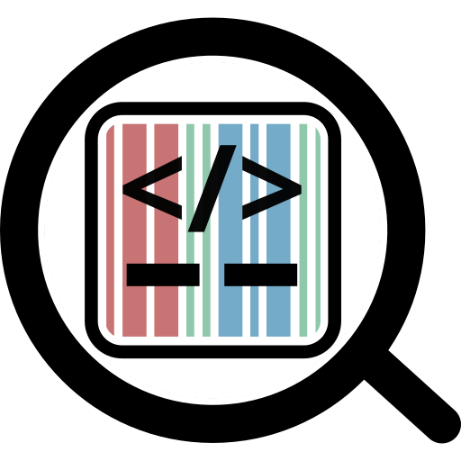

|logo|

|website| |gitpod| |github| |issues| |license| |docs|

.. |website| image:: https://img.shields.io/website?url=https%3A%2F%2Ffind-software-scholia-qlever.toolforge.org%2F
           :target: https://find-software-scholia-qlever.toolforge.org/
           :alt: Website

.. |gitpod| image:: https://img.shields.io/badge/Gitpod-Open%20in%20Gitpod-%230092CF.svg
           :target: https://gitpod.io/#https://github.com/findsoftware/scholia-find-software
           :alt: Gitpod
.. |github| image:: https://img.shields.io/github/last-commit/findsoftware/scholia-find-software.svg
   :target: https://github.com/findsoftware/scholia-find-software
   :alt: Github last commit
.. |issues| image:: https://img.shields.io/github/issues/findsoftware/scholia-find-software.svg
   :target: https://github.com/findsoftware/scholia-find-software/issues
   :alt: GitHub issues
.. |license| image:: https://img.shields.io/badge/License-GPLv3-blue.svg
   :target: https://github.com/findsoftware/scholia-find-software/blob/main/LICENSE
   :alt: License
.. |docs| image:: https://readthedocs.org/projects/scholia/badge/?version=latest
   :target: https://scholia.readthedocs.io/en/latest/?badge=latest
   :alt: Upstream Scholia documentation

find.software
=============

find.software is a Wikidata_-based webapp for discovering research software,
built on `Scholia <https://github.com/WDscholia/scholia>`_.

Installation
------------
find.software can be installed directly from GitHub with:

.. code-block:: shell

    $ python3 -m pip install git+https://github.com/findsoftware/scholia-find-software

It can be installed in development mode with:

.. code-block:: shell

    $ git clone https://github.com/findsoftware/scholia-find-software
    $ cd scholia-find-software
    $ pip install --editable .

Webapp
------

As a webapp, it currently runs from `Wikimedia Toolforge`_, a facility provided by the `Wikimedia Foundation`_. It is accessible from

    https://find-software-scholia-qlever.toolforge.org/

The webapp helps users discover research software and explore related information in Wikidata.

The information displayed on the page is only what is available in Wikidata.

Run locally from the repository root after installing in development mode:

.. code-block:: sh

    $ python -m flask --app runserver:app run --debug --host 127.0.0.1 --port 8100

Script
------

It is possible to use methods of the scholia package as a script:

.. code-block:: sh

    $ python -m scholia.query twitter-to-q fnielsen
    Q20980928

Contributing
------------

A simple way to get up and running is to `launch find.software via Gitpod`_, which installs the dependencies listed in `requirements.txt`_ automatically and launches the web app via `runserver.py`_.

See file `CONTRIBUTING.rst`_ for technical details on contributing to the underlying Scholia application.

.. _Wikidata: https://www.wikidata.org
.. _Wikimedia Foundation: https://wikimediafoundation.org
.. _Wikimedia Toolforge: https://toolforge.org/
.. _launch find.software via Gitpod: https://gitpod.io/#https://github.com/findsoftware/scholia-find-software
.. _CONTRIBUTING.rst: https://github.com/findsoftware/scholia-find-software/blob/main/CONTRIBUTING.rst
.. _requirements.txt: https://github.com/findsoftware/scholia-find-software/blob/main/requirements.txt
.. _runserver.py: https://github.com/findsoftware/scholia-find-software/blob/main/runserver.py

References
----------
- Scholia's page about itself: https://scholia.toolforge.org/topic/Q45340488
- Wikidata overview page about Scholia: https://www.wikidata.org/wiki/Wikidata:Scholia
- Lane Rasberry, Egon Willighagen, Finn Nielsen, Daniel Mietchen, "Robustifying Scholia: paving the way for knowledge discovery and research assessment through Wikidata. Research Ideas and Outcomes", 2019, RIO Journal, 5: e35820. https://doi.org/10.3897/rio.5.e35820
- Finn Årup Nielsen, Daniel Mietchen, Egon Willighagen, "Scholia and scientometrics with Wikidata", Joint Proceedings of the 1st International Workshop on Scientometrics and 1st International Workshop on Enabling Decentralised Scholarly Communication, 2017. http://ceur-ws.org/Vol-1878/article-03.pdf
- Finn Årup Nielsen, Daniel Mietchen, Egon Willighagen, "Scholia, Scientometrics and Wikidata", The Semantic Web: ESWC 2017 Satellite Events, 2017. DOI: `10.1007/978-3-319-70407-4_36 <https://doi.org/10.1007/978-3-319-70407-4_36>`_. https://link.springer.com/content/pdf/10.1007%2F978-3-319-70407-4_36.pdf
